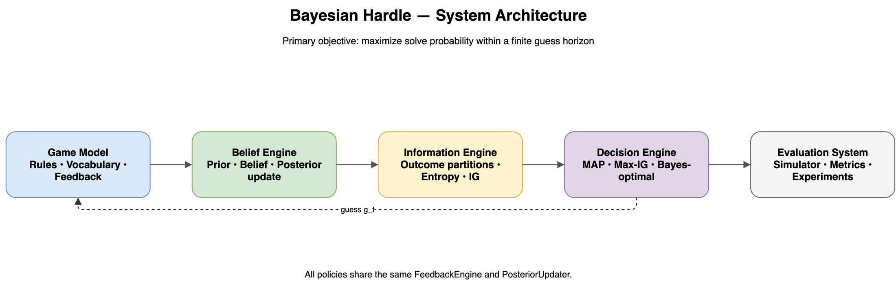

# Bayesian Hardle

Bayesian Hardle is a research-oriented solver for a Hardle-style word-feedback game. It treats each round as sequential Bayesian inference: maintain a posterior over candidate answers, partition possible feedback outcomes, measure expected information gain, and choose the next action with policies ranging from random and MAP baselines to Max-IG and exact finite-horizon planning on tractable scopes.

The project is useful as a compact example of **Bayesian inference, information theory, sequential decision-making, and exact-vs-scalable planning** in one reproducible system.

## What is implemented

- Duplicate-aware Hardle feedback semantics.
- Uniform priors and deterministic posterior filtering.
- Shannon entropy, expected posterior entropy, and information gain.
- Random, MAP, and Max-Information-Gain policies.
- An exact finite-horizon Bayesian planner for declared small scopes.
- Accelerated Max-IG and exact-planner paths with regression tests.
- A CLI plus an interactive Streamlit interface for solver-vs-game experiments.
- Reproducible experiment scripts and machine-readable result artifacts.

## Architecture

The runtime loop is deliberately split into five boundaries:

1. **Game model** defines legal actions, hidden targets, feedback, and terminal rules.
2. **Belief engine** updates the posterior from observed guess/feedback pairs.
3. **Information engine** partitions outcomes and computes entropy/information gain.
4. **Decision engine** selects actions from the current belief and remaining horizon.
5. **Evaluation layer** runs episodes and records metrics without exposing the hidden target to the solver.

This separation makes it possible to compare decision policies while keeping the game and belief semantics fixed.



## Setup

```bash
python3 -m venv .venv
source .venv/bin/activate
pip install -e .
python3 scripts/fetch_wordlists.py
```

The vocabulary preparation script downloads two pinned upstream word lists, verifies their SHA-256 hashes and expected counts, and writes the local files used by the experiments. The lists are intentionally not redistributed in this repository; see `data/wordlists/provenance.json` and `scripts/fetch_wordlists.py` for exact source revisions.

## Verify

Run the full test suite:

```bash
python3 -m unittest discover -s tests -v
```

Run the CLI:

```bash
bayesian-hardle --help
```

Run the interactive app:

```bash
uv run --with . streamlit run src/bayesian_hardle/streamlit_app.py
```

## Experiments

The `experiments/` directory contains controlled comparisons and performance studies. The full Random/MAP benchmark uses 2,315 candidate answers and 12,974 legal guesses. Full Max-IG uses the same vocabulary scope. Exact Bellman-style planning is intentionally restricted to smaller declared scopes because its computational cost grows rapidly with horizon and action space.

The repository keeps exact and scalable methods distinct: performance shortcuts are tested against the exact semantics they claim to preserve rather than presented as interchangeable approximations.

## Repository layout

- `src/bayesian_hardle/` — solver, game, application, and CLI code.
- `tests/` — behavioral and regression tests.
- `experiments/` — reproducible experiment runners and selected results.
- `scripts/` — deterministic data-preparation helpers.
- `data/wordlists/` — provenance metadata; generated word lists are local-only.
- `docs/` — architecture and research notes.

## Data provenance

The experiments use a historical Wordle answer list published by cfreshman and a legal-guess list from Al Sweigart's `wordletools`, plus the Hardle-specific additions `covid` and `padel`. Source URLs, pinned revisions, counts, and hashes are recorded in `data/wordlists/provenance.json`.

Because the redistribution status of the historical Wordle list is not explicit, this repository records provenance and fetches the inputs from their pinned sources instead of vendoring the list contents.

## Limitations

- Exact finite-horizon planning is computationally expensive and is not claimed to scale to the full action space at arbitrary horizons.
- Results depend on the pinned vocabulary and game semantics; changing either changes the decision problem.
- The project studies algorithmic decision-making in a word-feedback environment; it is not intended as a claim about human cognition.

## License

Code in this repository is released under the MIT License. External word lists fetched by the preparation script remain subject to their respective source terms.
